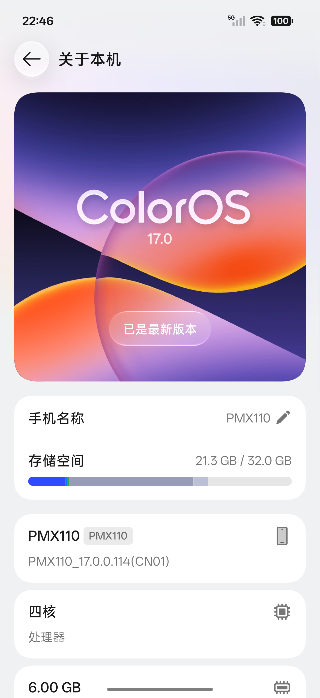
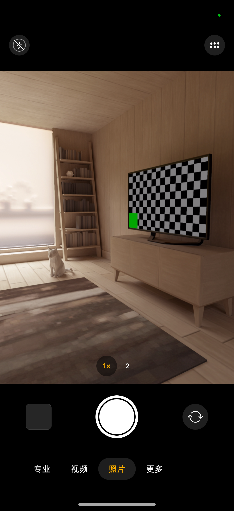

# ColorOS-AVD

在 Apple Silicon Mac 的 Android Studio ARM64 模拟器中运行 OPPO ColorOS。基于官方 OTA 适配，支持 ADB、KernelSU Root、GPU 加速和 SELinux Enforcing。

## 系统信息

| 项目     | 配置                                                   |
| -------- | ------------------------------------------------------ |
| 系统     | ColorOS 17 / Android 17（API 37）                      |
| 官方固件 | OPPO Find X10 Pro Max / `PMX110_17.0.0.114(CN01)`      |
| 硬件基底 | API 36 ARM64 revision 7 Ranchu Vendor / 4 KiB GKI 内核 |
| 默认资源 | 4 核 / 6 GiB RAM / 16 GiB 数据分区                     |
| 显示     | 1272 × 2772 / 560 dpi                                  |
| Root     | KernelSU v3.3.0                                        |

原生相机使用虚拟前后摄，支持预览、拍照和录像；实体多摄、人像和美颜不可用。详细能力范围见 [兼容性说明](docs/compatibility.md)。

## 运行截图

<table>
  <tr>
    <td align="center"><br />系统桌面</td>
    <td align="center"><br />关于本机</td>
    <td align="center"><br />系统相机</td>
    <td align="center"><br />系统相册</td>
  </tr>
</table>

## 安装与启动

在 Apple Silicon Mac 终端执行：

```sh
curl -fsSL https://github.com/YuKongA/ColorOS-AVD/releases/latest/download/install.sh | bash
```

安装向导提供目录、实例名称、端口和资源配置，下载并校验固件。需要 Python 3、Android Emulator / Platform-Tools 和 `e2fsprogs`；运行发布版无需 OTA、JDK 或 NDK。

安装完成后双击安装目录中的 `Start.command` 启动，`Install.command` 用于管理和更新，`Uninstall.command` 用于卸载。安装及数据保留说明见 [安装与启动](docs/installing.md)。

从源码构建使用 `Build-ColorOS.command`，步骤见 [重新构建](docs/rebuilding.md)。

## 文档

- [安装与启动](docs/installing.md)
- [重新构建](docs/rebuilding.md)
- [兼容性说明](docs/compatibility.md)
- [官方固件修改清单](docs/coloros-firmware-changes.md)

## 致谢

- [HyperOS-AVD](https://github.com/NEORUAA/HyperOS-AVD)
- [Android Emulator / AOSP](https://developer.android.com/studio/run/emulator-commandline)
- [KernelSU](https://github.com/tiann/KernelSU)
- [erofs-utils](https://git.kernel.org/pub/scm/linux/kernel/git/xiang/erofs-utils.git)
